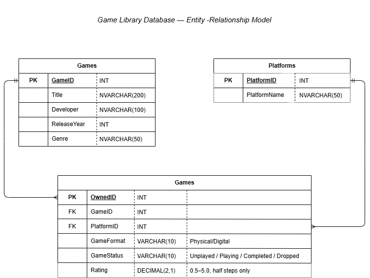

# Game Library Database
 
A SQL Server database I built to track the video games I own: which platform each copy is on, whether it's physical or digital, how far I've gotten, and how I'd rate it.
 
I built this to learn SQL from the ground up: designing tables, loading data, writing queries, and creating views and stored procedures. It runs on **Azure SQL Database**, and I wrote the scripts in **VS Code** (mssql extension) and **SSMS**.
 

 
## Tables
 
| Table | What it holds |
|---|---|
| **Games** | One row per game: title, developer, release year, genre |
| **Platforms** | One row per console/PC (PS5, Switch, Xbox 360, etc.) |
| **OwnedGames** | One row per copy I own. Links a game to a platform with format, status and rating |
 
**Relationships:** one game can have many owned copies (for example, Skyrim on three platforms), and one platform can have many games. OwnedGames connects the two with foreign keys.
 
**Rules built into the table (CHECK constraints):**
- `GameFormat` must be Physical or Digital
- `GameStatus` must be Unplayed, Playing, Completed or Dropped
- `Rating` must be 0.5–5.0 in half steps, or NULL if not rated yet
## Files
 
| File | What it does |
|---|---|
| `games_tracker.sql` | Creates the tables and loads the data |
| `queries.sql` | Practice queries: filtering, grouping, aggregates, HAVING, LEFT JOINs |
| `procedures.sql` | Stored procedures |
| `EntityRelationshipDiagram.png` | Entity-relationship diagram |
 
**To run it:** `games_tracker.sql` → `views.sql` → `procedures.sql`, then any query in `queries.sql`.
 
## View
 
| View | What it does |
|---|---|
| `vw_GameLibrary` | Joins OwnedGames, Games and Platforms into one readable list, so queries don't need to repeat the joins |
 
## Stored Procedures
 
| Procedure | Inputs | What it does |
|---|---|---|
| `GetGamesByPlatform` | @Platform | Lists the games I own on that platform |
| `GetGamesByStatus` | @Status | Lists games by status |
| `AddOwnedGame` | @GameID, @PlatformID, @GameFormat, @GameStatus, @Rating (optional) | Adds a new owned copy and picks the next OwnedID automatically |
| `UpdateGameProgress` | @Title, @Platform, @NewStatus, @NewRating (optional) | Updates a game's status/rating. Checks that exactly one copy matches before changing anything |
 
```sql
EXEC GetGamesByPlatform @Platform = 'Switch';
EXEC UpdateGameProgress @Title = 'Hades', @Platform = 'PC', @NewStatus = 'Completed', @NewRating = 5.0;
```
 
## Example Queries
 
```sql
-- Games per platform
SELECT PlatformName, COUNT(*) AS GameCount
FROM vw_GameLibrary
GROUP BY PlatformName
ORDER BY GameCount DESC;
 
-- Wishlist: games in the Games table with no owned copy
SELECT g.Title
FROM Games g
LEFT JOIN OwnedGames o ON g.GameID = o.GameID
WHERE o.OwnedID IS NULL;
```
 
## What I Learned
 
- **Designing tables that relate to each other:** splitting data into separate tables and connecting them with primary and foreign keys, instead of keeping everything in one big table.
- **Protecting data quality at the database level:** using `NOT NULL` and `CHECK` constraints so bad values can't get in, no matter who's entering the data.
- **Joins:** combining tables with `INNER JOIN`, and using `LEFT JOIN` to find what's *missing*, like games with no owned copy.
- **Summarizing data:** `GROUP BY` with `COUNT`, `AVG`, `MIN` and `MAX`, and the difference between filtering rows with `WHERE` and filtering groups with `HAVING`.
- **Views vs stored procedures:** a view is a saved query for reading data, while a stored procedure is saved logic that takes inputs and can change data, the way an app would call it.
- **Working in the cloud:** setting up and connecting to an Azure SQL database, including firewall rules and authentication.
## Next Steps
 
- Switch IDs to `IDENTITY` so the database numbers new rows automatically
- Connect the database to Power BI for a simple dashboard
 
